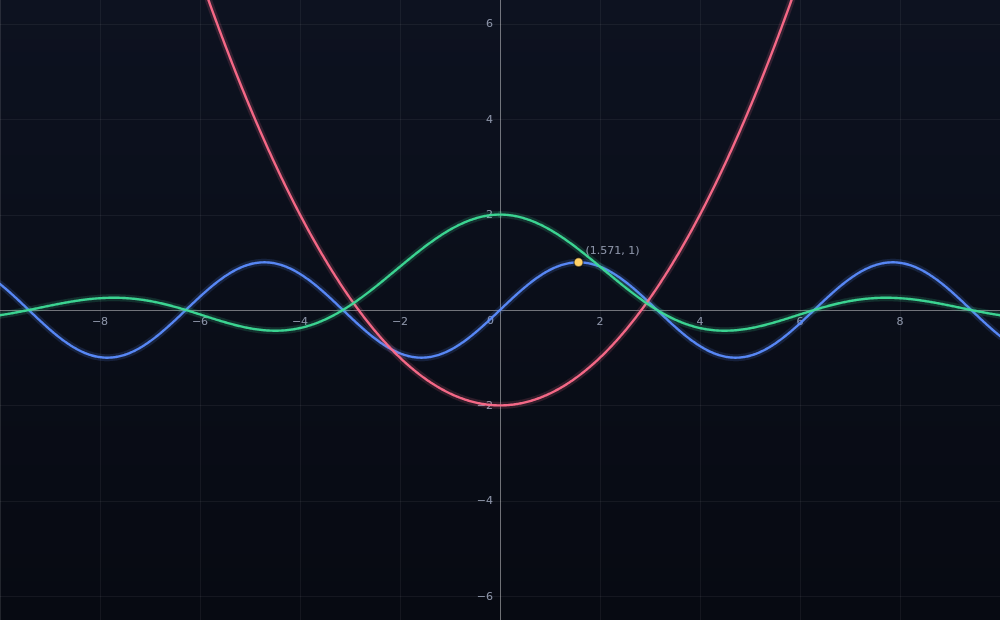

# Graphing Calculator

Type a formula, get a graph. That's the whole interface: the caret is already in
the formula box when the page opens, every keystroke re-plots, and everything
else (table, markers, cheatsheet) lives in a panel you can ignore.



**Open the website above.** That's it — nothing to install, nothing to configure.

## Using it

| | |
| --- | --- |
| **Graph a formula** | just type — `sin(x)`, `x^2 - 3`, `1/x`. No button, no submit. |
| **Add a curve** | `Enter` in the formula box grows a new row (or hit *+ Add curve*) |
| **Quick start** | click an example chip: `sin(x)`, `x^2 - 3`, `1/x`, `tan(x)`, `2 sin(x) / x`, `sqrt(x)`, `e^x`, `x^3 - 3x` |
| **Pan** | drag the canvas |
| **Zoom** | scroll wheel, `+` / `-`, or the toolbar |
| **Reset / square zoom / centre** | toolbar buttons, double-click, or `0` |
| **Trace** | hover near any curve — the readout shows the exact value |
| **Mark a point** | click empty space; markers list in the panel |
| **Degrees** | the `RAD` / `DEG` pill |
| **Fullscreen** | the Fullscreen button on a running build (double-click the view too). The **Exit fullscreen** button in the top-left corner always leaves; `Esc` does too whenever the page has your keys |
| **Keyboard** | your keys go to whatever you last touched — the game or the page. Press `K` to send them to the game, `K` again to take them back |

## What you can type

- operators `+ - * / % ^ !`, parentheses, unary minus, right-associative powers
- implicit multiplication: `2x`, `3(x+1)`, `x(x-1)`, `2sin(x)`, `x sin(x)`
- `sin cos tan csc sec cot asin acos atan atan2` (+ hyperbolics), `ln log log2 logb exp`,
  `sqrt cbrt nthroot`, `abs sign floor ceil round trunc`, `min max mod hypot pow`,
  `gamma ncr npr gcd lcm avg random`
- constants `pi π tau τ e phi φ infinity ∞`; `√ ∛ − × ÷ · ² ³` all work
- free parameters: `a·sin(b·x)` plots in `x` and holds `a`, `b` as parameters
- `5!`, `ncr(52,5)`, `-7 % 3` (= 2, mathematical modulo), `y = …` prefixes tolerated
- mistakes are explained inline under the row, and the other curves keep drawing

Everything is client-side: no backend, no accounts, no tracking. Formulas, angle
mode and your viewport are kept in `localStorage`.

## There's a secret

The calculator has one trick that has nothing to do with graphing. Type the
secret code into any formula box and the calculator takes you to a **whole other
page** — a shelf of everything you can play:

- **Versions** — 1.8.8, 1.5.2, EaglercraftPhi 1.9.4, EaglercraftZ 1.11.2,
  1.12.2, 1.13.2, 1.14.4, 1.15.2 and 1.16.5, each with the builds it ships.
  Anything with a single build plays straight away without a picker, and a build
  that isn't quite what its label suggests says so (1.13.2's second mirror is
  noted as 1.13.1, and not vanilla).
- **Clients** — Astra Client, Resent Client, Ayuncraft, Precision Client and
  Reflex Client, each with the builds it offers (Resent's third mirror is
  flagged as an older version, and Precision's second mirror mentions that it
  comes with texture packs).

Pick one, pick a build, and it opens full-page with **Fullscreen**, **Restart**
and **Another build** to hand. Back button, refresh and links all work, because
each step has its own URL:

```
#/play                     everything on the shelf
#/play/1.8.8               that version's builds
#/play/1.8.8/188-js-2      that build, running
```

Three details worth knowing:

- **Just start typing.** The formula box takes the first character you type even
  if nothing was focused, the page asks for the keyboard as soon as it possibly
  can, and keystrokes are counted wherever they land — a field that never took
  the character cannot cost you a retype. Controls act on release, so a card that
  shifts under the cursor still opens.
- **The keyboard follows your clicks.** Click the game and your keys are its; a
  chip in the control bar always says which side is listening. Gameplay keys
  pressed on the page are swallowed rather than scrolling it, so nothing fights
  the game for input.
- **`K` is the keyboard switch.** Press it to hand every key to the game
  (WASD, Esc, T — whatever the build wants), press it again to take them back
  and use the page. Because a build that has focus receives the keys itself, the
  chip doubles as the click-to-release control.
- **Fullscreen is mocked, on purpose.** No permissions, no browser prompts: the
  running view simply becomes the whole window, and `Esc` returns it to the
  windowed layout. `Esc` again walks back up through Play to the shelf. The
  controls fade away after a second so nothing sits over the game — moving the
  mouse to the top edge brings them back for as long as you are using them.
- **You can always get out.** Because a running build owns the keyboard, the way
  out is a button rather than a key: **Exit fullscreen** sits in the top-left
  corner of the whole view, above the game, from the moment you go fullscreen
  until you leave. The little message that says so removes itself from the page
  after a few seconds.

The code itself is short, and it lives in `src/unlock.js`. You'll know it when
you see it.

Want another version, client or build on the shelf? Add it to `src/catalog.js` —
the page and the tests both read that list, so a single entry is all it takes.

## Project layout

```
index.html            app shell: composer on top, graph below, detail rail
styles.css            dark theme, CSS custom properties
server.js             zero-dependency static server (strict allow-list)
src/math-engine.js    tokenizer -> parser -> compiled closures, formatting
src/graph.js          viewport, sampling, discontinuity splitting, rendering
src/app.js            wiring: formula rows, table, toolbar, examples, shortcuts
src/unlock.js         the secret code and its detection
src/router.js         hash routes, so each screen has a real URL
src/play-page.js      the play page: shelf -> builds -> running build
src/catalog.js        the shelf: versions, clients and their builds
tests/                130 assertions, see below
docs/graph-preview.png generated by the render test
```

## Tests

```bash
npm test            # everything
npm run test:unit   # parser/math engine, the shelf, the router and the secret code
```

| Suite | What it proves |
| --- | --- |
| `math.test.mjs` | parser, precedence, implicit ×, functions, angle modes, errors |
| `catalog.test.mjs` | every build URL (versions **and** clients), grouping, Resent's older mirror, Precision's texture-pack note, single-mirror entries (1.11.2, Ayuncraft, Reflex) |
| `router.test.mjs` | route parsing and parent routes, so Back always makes sense |
| `unlock.test.mjs` | the code matches, lookalikes don't, half-typed input stays quiet |
| `server.test.mjs` | assets are served; `.git`, `node_modules`, `package.json` are not |
| `app.smoke.test.mjs` | the real UI in jsdom: typing anywhere (including keystrokes that land on a field that cannot hold them), the whole play flow, whole-card clicking, the one-gesture-one-action rule, the K keyboard switch, mocked fullscreen, the fade-after-a-second controls, the top-edge strip, the always-available exit, the self-clearing message, Esc behaviour |
| `deep-link.test.mjs` | opening `#/play/...` URLs straight into a build, single-mirror shortcuts, bad URLs falling back |
| `type-to-graph.test.mjs` | **real pixels**: typing into the input box draws a curve, in the right colour, both branches, hide/show, zoom |
| `render.test.mjs` | raster rendering: grid, colours, viewport coverage, domain holes, `tan(x)` asymptote splitting |

The last two use a real canvas (`@napi-rs/canvas`) rather than a stub, and
`render.test.mjs` regenerates `docs/graph-preview.png`.
